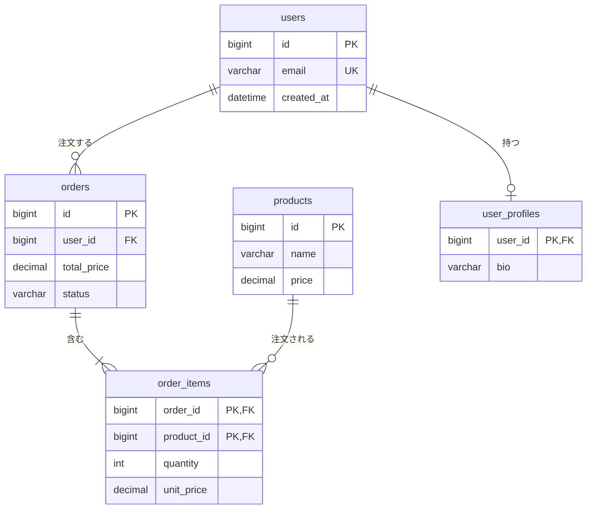

テーブル設計はシステムの土台です。
ここが崩れると、あらゆる機能の実装に歪みが伝播します。
逆に、テーブル設計がしっかりしていれば、APIもバリデーションも自然と整います。

この章では、ER図の読み書きから正規化の考え方、実務での判断基準までを整理します。

<SpeechBubble character="/images/usingcomputer_suit_woman_color.png" name="学習者">
テーブル設計って、とりあえず必要そうなカラムを並べればいいんじゃないの？正規化って何…？
</SpeechBubble>

## ER図とは何か

ER図（Entity-Relationship Diagram）は、データの構造とリレーション（関連）を可視化する図です。
テーブル設計の前にER図を描くことで、「どのデータがどう関係しているか」をチーム内で合意できます。

<MermaidDiagram chart={`
erDiagram
    users ||--o{ orders : "注文する"
    orders ||--|{ order_items : "含む"
    products ||--o{ order_items : "注文される"
    users ||--o| user_profiles : "持つ"
    users {
        bigint id PK
        varchar email UK
        datetime created_at
    }
    orders {
        bigint id PK
        bigint user_id FK
        decimal total_price
        varchar status
    }
    order_items {
        bigint order_id PK, FK
        bigint product_id PK, FK
        int quantity
        decimal unit_price
    }
    products {
        bigint id PK
        varchar name
        decimal price
    }
    user_profiles {
        bigint user_id PK, FK
        varchar bio
    }
`} />

### 線の両端の記号を読む

ER図では、テーブル（エンティティ）を箱で、関連を線で表します。上の図は、線の両端に付ける記号で「相手が何件ありうるか」を示す **IE記法**（鳥の足記法）です。

<SpeechBubble character="/images/question_woman_04_color.png" name="学習者">
線の端っこにある、丸とか棒とか三つ又の記号は何を表しているの？
</SpeechBubble>

記号は2つの部品の組み合わせです。箱に近い側が「最大で何件か」、遠い側が「最小で何件か」を表します。

| 部品 | 意味 |
|---|---|
| 縦棒 | 1 |
| 丸 | 0 |
| 三つ又（鳥の足） | 多 |

| 記号の組み合わせ | 読み方 | Mermaidでの書き方 |
|---|---|---|
| 縦棒が2本 | 必ず1件 | `\|\|` |
| 丸と縦棒 | 0件か1件 | `o\|` または `\|o` |
| 縦棒と三つ又 | 1件以上 | `\|{` または `}\|` |
| 丸と三つ又 | 0件以上 | `o{` または `}o` |

記号は、線をたどった**先のテーブル側**に書かれたものを読みます。`users` と `orders` の線を例にします。

1. `users` 側の端は縦棒が2本です。1件の注文には、ユーザーが**必ず1人**対応します
2. `orders` 側の端は丸と三つ又です。1人のユーザーには、注文が**0件以上**対応します

`orders` と `order_items` の線では、`order_items` 側が縦棒と三つ又（1件以上）になっています。明細が1件も無い注文は存在しない、という業務ルールを図に書き込んでいます。

### Mermaidでの書き方

上の図は、Mermaidの `erDiagram` で書いています。



| 記法 | 意味 |
|---|---|
| `users \|\|--o{ orders : "注文する"` | 関連を1本書く。左右の記号が、それぞれの側の件数 |
| `--` | 実線。相手のテーブルが無いと存在できない関連 |
| `..` | 破線。互いに独立して存在できる関連 |
| `users { bigint id PK }` | テーブルの列を書く。型、列名、キーの順 |
| `PK` / `FK` / `UK` | 主キー / 外部キー / 一意キー |

<Figure src="/images/planning_suit_man_color.png" alt="設計を考えるエンジニア" caption="ER図はコードを書く前に、データ構造をチームで合意するための設計図" maxWidth="280px" />

## リレーションの種類

| リレーション | 説明 | 例 |
|---|---|---|
| 1:1 | 一方のレコードに対して相手も1つ | users ↔ user_profiles |
| 1:N | 一方のレコードに対して相手が複数 | users → orders |
| N:N | 双方とも複数（中間テーブルが必要） | products ↔ tags |

### 中間テーブルが必要になるケース

N:N のリレーションは、RDBでは直接表現できません。中間テーブルを置いて、2つの1:Nに分解します。

```sql
-- 商品とタグの N:N → 中間テーブル product_tags で解決
CREATE TABLE product_tags (
  product_id INT NOT NULL,
  tag_id     INT NOT NULL,
  PRIMARY KEY (product_id, tag_id),
  FOREIGN KEY (product_id) REFERENCES products(id),
  FOREIGN KEY (tag_id)     REFERENCES tags(id)
);
```

<MermaidDiagram chart={`
erDiagram
    products ||--o{ product_tags : ""
    tags ||--o{ product_tags : ""
    product_tags {
        int product_id PK, FK
        int tag_id PK, FK
    }
`} />

## 正規化 — データの重複を排除する

正規化は、データの冗長性を減らし、更新時の矛盾を防ぐための設計手法です。

### 第1正規形（1NF）— 繰り返しを排除する

1つのカラムに複数の値を入れない。

**❌ 非正規形**

| `order_id` | `items` |
|---|---|
| 1 | りんご、みかん |

**✅ 第1正規形**

| `order_id` | `item` |
|---|---|
| 1 | りんご |
| 1 | みかん |

### 第2正規形（2NF）— 部分関数従属を排除する

複合主キーの一部にだけ依存するカラムを別テーブルに分ける。

**❌ 部分関数従属あり**

| `order_id` | `product_id` | `product_name` | `quantity` |
|---|---|---|---|
| 1 | 101 | りんご | 3 |

`product_name` は `product_id` だけで決まり、`order_id` には依存しません。

**✅ 第2正規形**

| テーブル | カラム |
|---|---|
| `order_items` | `order_id`, `product_id`, `quantity` |
| `products` | `product_id`, `product_name` |

### 第3正規形（3NF）— 推移的関数従属を排除する

主キー以外のカラムに依存するカラムを別テーブルに分ける。

**❌ 推移的関数従属あり**

| `user_id` | `department_id` | `department_name` |
|---|---|---|
| 1 | 10 | 営業部 |

`department_name` は `department_id` で決まり、`user_id` からは間接的に決まります。

**✅ 第3正規形**

| テーブル | カラム |
|---|---|
| `users` | `user_id`, `department_id` |
| `departments` | `department_id`, `department_name` |

<SpeechBubble character="/images/oksign_man_color.png" name="先生" side="right">
実務では第3正規形まで整理すれば十分なケースがほとんど。「同じデータが2箇所以上に書いてあるなら、正規化を疑う」と覚えておくと判断しやすいよ。
</SpeechBubble>

## 非正規化する判断基準

正規化は原則だが、パフォーマンスのために意図的に崩す場合があります。

| 場面 | 非正規化の例 | 理由 |
|---|---|---|
| 参照が圧倒的に多い | ユーザー名をordersテーブルにも持つ | JOINを減らして読み取り速度を上げる |
| 集計をリアルタイムで見せたい | 注文合計金額をordersに持つ | 毎回SUM()するより速い |
| 履歴として固定したい | 注文時点の商品価格をorder_itemsに持つ | 商品の値段が変わっても注文時の金額を保持 |

<Callout type="warning" title="非正規化は意図的にやる">
非正規化は「正規化のルールを知った上で、理由をもって崩す」行為です。最初から正規化せずにテーブルを作るのとは全く違います。非正規化した理由をテーブル定義書やコメントに残しておくことが重要です。
</Callout>

## 論理削除カラム（deleted_at）の設計

レコードを物理的にDELETEせず、`deleted_at` カラムで「削除済み」を表現する手法。

```sql
ALTER TABLE users ADD COLUMN deleted_at DATETIME NULL DEFAULT NULL;

-- 論理削除
UPDATE users SET deleted_at = NOW() WHERE id = 1;

-- 有効なユーザーだけ取得
SELECT * FROM users WHERE deleted_at IS NULL;
```

| 方式 | メリット | デメリット |
|---|---|---|
| 論理削除 | 復元が容易、監査ログ代わりになる | 全クエリに `WHERE deleted_at IS NULL` が必要 |
| 物理削除 | クエリがシンプル | 復元不可、参照整合性に注意 |

<Marker>論理削除を採用するなら、全クエリに条件を付け忘れない仕組み（ORM のデフォルトスコープなど）を入れること。</Marker>

### 論理削除するとUNIQUE制約にぶつかる

`email` に `UNIQUE` 制約があるテーブルで論理削除をすると、退会したユーザーが同じメールアドレスで再登録できなくなります。行が残っているので、制約から見れば重複のままです。MySQL 8.4で実行した結果です。

```sql
INSERT INTO users (email) VALUES ('a@example.com');
UPDATE users SET deleted_at = NOW() WHERE id = 1;  -- 論理削除
INSERT INTO users (email) VALUES ('a@example.com');
-- ERROR 1062 (23000): Duplicate entry 'a@example.com' for key 'users.uk_email'
```

MySQLでは、「削除されていない行のときだけ値が入る列」を生成列として作り、そちらに `UNIQUE` を付ける方法があります。`UNIQUE` 制約は `NULL` どうしを重複とみなさないので、削除済みの行は制約の対象から外れます。

```sql
ALTER TABLE users
  ADD COLUMN active_email VARCHAR(255)
    AS (IF(deleted_at IS NULL, email, NULL)) STORED,
  ADD UNIQUE KEY uk_users_active_email (active_email);
```

| 状態 | `email` | `active_email` |
|---|---|---|
| 論理削除済み | `a@example.com` | `NULL` |
| 有効 | `a@example.com` | `a@example.com` |

この形にすると、有効な行どうしの重複は引き続き `ERROR 1062` で防がれ、削除済みの行と同じメールアドレスでの再登録は通ります。PostgreSQLでは、`CREATE UNIQUE INDEX ... WHERE deleted_at IS NULL` という部分インデックスで同じことができます。

<Callout type="warning" title="外部キーで参照されている行は物理削除できない">
物理削除を選んだ場合の注意点です。注文や決済の履歴から `users.id` を外部キーで参照していると、そのユーザーの行は `DELETE` できず、エラーになります。「退会したら行を消す」と決める前に、どのテーブルから参照されているかをER図で確認します。履歴を残す必要があるなら、論理削除にするか、個人情報の列だけを消して行を残す設計になります。
</Callout>

## インデックス設計の基本

インデックスはテーブルの検索を高速化するが、書き込み時にはオーバーヘッドが生じます。

```sql
-- WHERE句で頻繁に使うカラムにインデックスを張る
CREATE INDEX idx_users_email ON users(email);

-- 複合インデックス（左端のカラムから使われる）
CREATE INDEX idx_orders_user_status ON orders(user_id, status);
```

| 張るべき場所 | 理由 |
|---|---|
| WHERE句の条件カラム | 検索を高速化 |
| JOIN条件のカラム | 結合を高速化 |
| 外部キーのカラム | 参照整合性チェックと結合を高速化（下の注を参照） |
| ORDER BY / GROUP BY のカラム | ソート・集計を高速化 |

外部キーのカラムの扱いは、データベースによって違います。

| データベース | 外部キーを宣言したとき |
|---|---|
| MySQL（InnoDB） | 参照する側のカラムに、インデックスが無ければ自動で作られる（[MySQL 8.4 リファレンス](https://dev.mysql.com/doc/refman/8.4/en/create-table-foreign-keys.html)、英語） |
| PostgreSQL | 自動では作られない。必要なら自分で作る（[PostgreSQL 17 文書](https://www.postgresql.jp/document/17/html/ddl-constraints.html)） |

複合インデックスの列の順番の決め方と、実行計画での確かめ方は、[MySQLの「インデックスとEXPLAIN」の章](/books/mysql/indexes-and-explain)で扱っています。

<Callout type="info" title="インデックスを増やすと書き込みが遅くなる">
すべてのカラムにインデックスを張ると、INSERT/UPDATEが遅くなります。実際のクエリパターンを見て、効果の高いものに絞って張るのが基本です。
</Callout>

## テーブル定義書のテンプレート

実務では、ER図とあわせてテーブル定義書を残します。

**テーブル名:** `orders`

**説明:** 注文情報を管理する

| カラム名 | 型 | NULL | デフォルト | 説明 |
|---|---|---|---|---|
| `id` | `BIGINT` | NO | `AUTO_INCREMENT` | 主キー |
| `user_id` | `BIGINT` | NO | — | 外部キー: `users.id` |
| `total_price` | `DECIMAL(10,2)` | NO | — | 注文合計金額（税込） |
| `status` | `VARCHAR(20)` | NO | `'pending'` | `pending` / `paid` / `shipped` / `cancelled` |
| `created_at` | `DATETIME` | NO | `CURRENT_TIMESTAMP` | 作成日時 |
| `updated_at` | `DATETIME` | NO | `CURRENT_TIMESTAMP`（更新時にも自動で現在時刻） | 更新日時 |
| `deleted_at` | `DATETIME` | YES | `NULL` | 論理削除日時 |

`updated_at` は、デフォルト値を指定しただけでは更新時に変わりません。MySQLでは `ON UPDATE CURRENT_TIMESTAMP` を付けます。

```sql
updated_at DATETIME NOT NULL
  DEFAULT CURRENT_TIMESTAMP
  ON UPDATE CURRENT_TIMESTAMP
```

<Callout type="warning" title="MySQLのTIMESTAMP型は2038年までしか入らない">
MySQLの `TIMESTAMP` 型が扱える範囲は、UTCで `2038-01-19 03:14:07` までです（[MySQL 8.4 リファレンス](https://dev.mysql.com/doc/refman/8.4/en/datetime.html)、英語）。MySQL 8.4で、それより1秒あとの値を入れると `ERROR 1292: Incorrect datetime value` で失敗しました。有効期限や予約日のように先の日付を入れる列では、すでに届く範囲です。`DATETIME` 型は9999年まで扱えます。型の選び方は[MySQLの「データ型の選び方」の章](/books/mysql/data-types)で扱っています。
</Callout>

**インデックス**

- `idx_orders_user_id (user_id)`
- `idx_orders_status (status)`

**非正規化の意図**

- `total_price`: 注文時点の合計金額を保持し、商品価格変更の影響を受けないようにする

## ちゃんと使うためのポイント

- <Marker>テーブル設計はシステムの土台。後から変更するコストが最も高い</Marker>
- まずER図で全体のリレーションを俯瞰し、その後カラムレベルに落とす
- 正規化は原則だが、パフォーマンス要件によっては意図的に崩す判断もある
- N:N は中間テーブルで 1:N × 2 に分解する
- 論理削除を使うなら、全クエリに条件を忘れない仕組みを入れる
- インデックスはクエリパターンに応じて効果の高いものに絞る
- 「なぜこの構造にしたか」をテーブル定義書に残しておく

- ER図の線の記号は、たどった先のテーブル側を読む。縦棒は1、丸は0、三つ又は多
- 論理削除と `UNIQUE` 制約は衝突する。再登録を許すなら、有効な行だけを対象にした一意制約にする

テーブルの上に乗るAPIの設計は、[API設計の基本](/books/system-design/06-api-design)で扱っています。

## 参考リンク

- [Entity Relationship Diagrams — Mermaid公式](https://mermaid.js.org/syntax/entityRelationshipDiagram.html) — `erDiagram` の記法（英語）
- [FOREIGN KEY Constraints — MySQL 8.4 リファレンス](https://dev.mysql.com/doc/refman/8.4/en/create-table-foreign-keys.html) — 外部キーとインデックスの関係（英語）
- [The DATE, DATETIME, and TIMESTAMP Types — MySQL 8.4 リファレンス](https://dev.mysql.com/doc/refman/8.4/en/datetime.html) — 各型が扱える範囲（英語）
- [制約 — PostgreSQL 17 文書](https://www.postgresql.jp/document/17/html/ddl-constraints.html) — 外部キー制約の日本語解説
