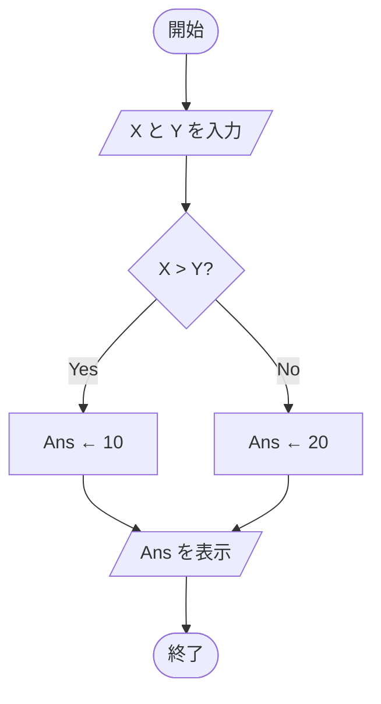

設計書に文章だけを書き連ねても、処理の流れは伝わりにくいものです。
「どの順番で」「誰が」「何をするか」を一目で把握するために、図を使います。

この章では、代表的な3つの図——**フローチャート**、**スイムレーン図**、**シーケンス図**——の使い分けと、Mermaidでの書き方を整理します。

<SpeechBubble character="/images/usingcomputer_suit_woman_color.png" name="学習者">
処理の流れを図にしたいんだけど、フローチャートとシーケンス図ってどう使い分けるの？
</SpeechBubble>

## フローチャート — 分岐ロジックの可視化

フローチャートは処理のステップと分岐を直線的に表現します。
1つのシステム・1人のアクターの処理を追うのに向いています。

### 基本記号と意味

フローチャートは、図形ごとに役割が決まっています。まずは次の5つを押さえれば、一般的な処理フローを読み書きできます。

<MermaidDiagram chart={`
flowchart TB
    START(["開始・終了"])
    PROCESS["処理"]
    DECISION{"判断・条件分岐"}
    IO[/"入力・出力"/]
    STORE[("データの保存先")]
    START ~~~ PROCESS ~~~ DECISION ~~~ IO ~~~ STORE
`} />

| 役割 | Mermaid記法 | 書く内容の例 |
|---|---|---|
| 開始・終了 | `A(["開始"])` | 開始、終了 |
| 処理 | `B["データを保存"]` | 計算、代入、API呼び出し |
| 判断・条件分岐 | `C{"入力は正しい?"}` | Yes / Noで答えられる条件 |
| 入力・出力 | `D[/"値を入力"/]` | ユーザー入力、画面表示 |
| データの保存先 | `E[("データベース")]` | DB、永続ストレージ |

<Marker>長方形には「行う処理」、ひし形には「答えによって進路が変わる質問」を書きます。</Marker>

基本的な条件分岐を、開始と終了まで含めて書くと次の形になります。

<MermaidDiagram chart={`
flowchart TB
    START(["開始"]) --> INPUT[/"X と Y を入力"/]
    INPUT --> CHECK{"X > Y?"}
    CHECK -->|Yes| YES["Ans ← 10"]
    CHECK -->|No| NO["Ans ← 20"]
    YES --> OUTPUT[/"Ans を表示"/]
    NO --> OUTPUT
    OUTPUT --> END(["終了"])
`} />

### 矢印・分岐・合流の読み方

- **矢印**は処理が進む方向を示す。通常は上から下、または左から右へ揃える
- **ひし形から出る矢印**には `Yes / No`、`成功 / 失敗`、`あり / なし` など、どちらの条件かを書く
- **分岐先が同じ処理へ戻る場合**は、上の `OUTPUT` のように2本の矢印を同じ長方形へつなげて合流させる
- **ループ**は後ろの処理から判断へ矢印を戻す。ただし交差する線が増えるなら、処理を分けるか別の図にする

<Callout type="warning" title="ひし形には質問を1つだけ書く">
「ログイン済みで管理者？」のように複数条件を1つへ詰め込むと、Noが何を意味するのか曖昧になります。「ログイン済み？」と「管理者？」を別々のひし形に分けましょう。
</Callout>

### Mermaidでの書き方

上の図は、次のMermaid記法で作れます。ここは完成形ではなく**図を生成するためのコード例**なので、コードブロックで表示しています。

`flowchart` の後ろは図が進む方向です。

| 指定 | 方向 | 向いている図 |
|---|---|---|
| `TB` / `TD` | 上から下 | 手順や分岐を順番に読む図 |
| `LR` | 左から右 | 工程が少ない横長の図 |
| `BT` | 下から上 | 下位から上位へ集約する図 |
| `RL` | 右から左 | 特別なレイアウトが必要な場合 |

ノードの `START` や `CHECK` は、図の中で要素を識別するIDです。表示する文言は括弧内の `"開始"` や `"X > Y?"` に書き、`-->` でノード同士をつなぎます。矢印の途中に `|Yes|` のように書くと、分岐条件を表示できます。

フローチャートは分岐の全体像を俯瞰するのに適していますが、**「誰が」その処理をしているか**が見えにくいという弱点があります。
1つのフローの中に「フロントの処理」「バックエンドの処理」「DBの処理」が混在すると、責任の所在が曖昧になります。

### いつフローチャートを使うか

- 分岐条件が多いビジネスロジック（割引計算、ステータス遷移など）
- 単一コンポーネント内の処理手順
- エラーハンドリングの全体像

## スイムレーン図 — 「誰が何をするか」を明確にする

<Figure src="/images/planning_suit_man_color.png" alt="フロー図を描く人" maxWidth="120px" />

スイムレーン図は、フローチャートに**アクター（担当者・システム）のレーン**を加えたものです。
複数のアクターが関わる処理では、フローチャートよりも「責任の所在」が一目で分かります。

<MermaidDiagram chart={`
flowchart TB
    subgraph Client["クライアント"]
        A["リクエスト送信"]
        H["レスポンス受信"]
    end
    subgraph APIGateway["APIゲートウェイ"]
        B["認証チェック"]
        C["ルーティング"]
    end
    subgraph Backend["バックエンドAPI"]
        D["バリデーション"]
        E["ビジネスロジック"]
    end
    subgraph DB["データベース"]
        F["クエリ実行"]
        G["結果返却"]
    end
    A --> B
    B --> C
    C --> D
    D --> E
    E --> F
    F --> G
    G --> E
    E --> H
`} />

レーンの境界がそのまま**責任の境界**になるため、「ここまではフロントの仕事、ここからはバックエンド」と視覚的に合意できます。

<SpeechBubble character="/images/usingcomputer_suit_woman_color.png" name="学習者">
設計レビューで「この処理、フロントとバックどっちの責任？」ってよく揉めるんだけど…
</SpeechBubble>

<SpeechBubble character="/images/relief_man_color.png" name="先生" side="right">
まさにそういう場面でスイムレーン図が効くんだ。レーンの境界が責任の境界になるから、文章で議論するよりずっと早く合意できるよ。
</SpeechBubble>

### いつスイムレーン図を使うか

- フロントエンド・バックエンド・外部サービスなど複数システムが連携する処理
- 設計レビューで「どこまでがどのレイヤーの責任か」を合意したいとき
- マイクロサービス間の連携フロー

## シーケンス図 — 時系列のメッセージ交換

> このセクションは現在執筆中です。
>
> - シーケンス図の基本記法（ライフライン、メッセージ、アクティベーション）
> - MermaidのsequenceDiagram構文
> - 同期・非同期メッセージの書き分け
> - ループ・条件分岐の表現（alt / loop / opt）

## フローチャート・スイムレーン・シーケンス図の使い分け

| 図 | 焦点 | 適するケース |
|---|---|---|
| **フローチャート** | 処理の分岐 | 単一コンポーネントのロジック、分岐条件の整理 |
| **スイムレーン図** | 責任の所在 | 複数アクターの連携、責任分界点の合意 |
| **シーケンス図** | 時系列のやりとり | リクエスト→レスポンスの往復、非同期処理の順序 |

<Callout type="column">
スイムレーン図はフローチャートの拡張（レーンを追加したもの）、シーケンス図はアクター間のメッセージの時系列表現です。どちらも「複数アクターの連携」を表現できますが、スイムレーンは**各アクター内部の処理ステップ**も見せられる点が異なります。迷ったら「内部の処理分岐も見せたいか、やりとりの順序だけ見せたいか」で選びましょう。
</Callout>

## ちゃんと使うためのポイント

- <Marker>フローチャートは分岐ロジックの整理に、スイムレーンは責任分界点の明確化に使う</Marker>
- 複数アクターが絡む処理をフローチャートだけで書くと「誰の責任か」が曖昧になる
- シーケンス図はリクエスト→レスポンスの往復を時系列で示したいときに最適
- すべての処理を図にする必要はない——**分岐が多い処理**や**複数システムが連携する処理**に絞る

## 参考リンク

- [Mermaid公式 — Flowcharts Syntax](https://mermaid.js.org/syntax/flowchart.html) — ノードの形、矢印、ラベル、サブグラフなどの公式記法

次の章では、ユーザーの操作に伴うページ間の移動を設計する**画面遷移図**を解説します。
