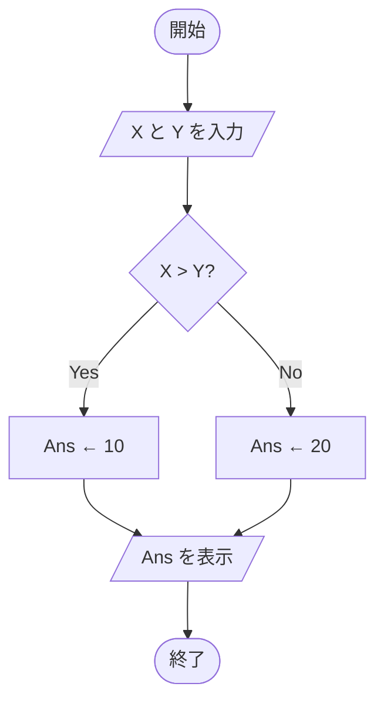
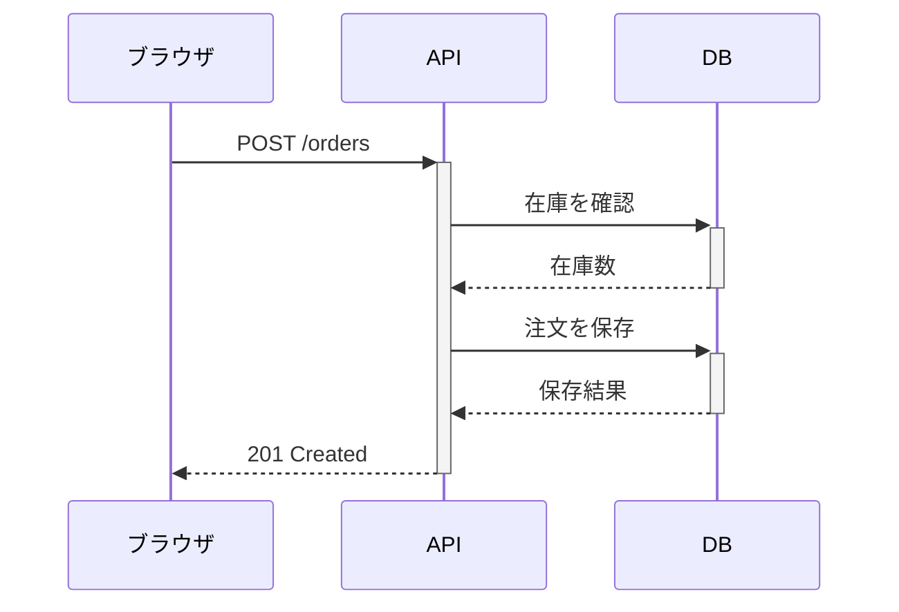
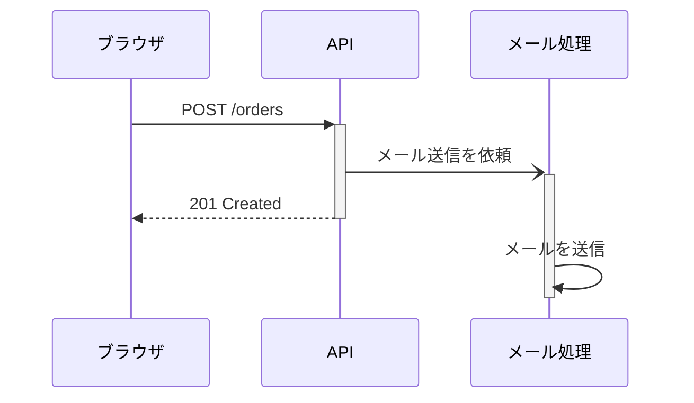
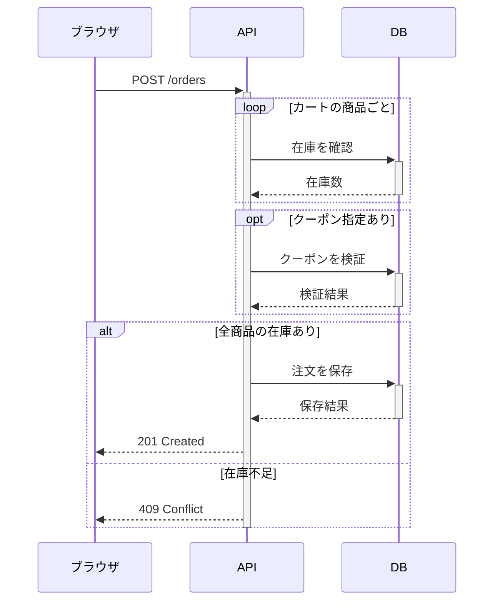
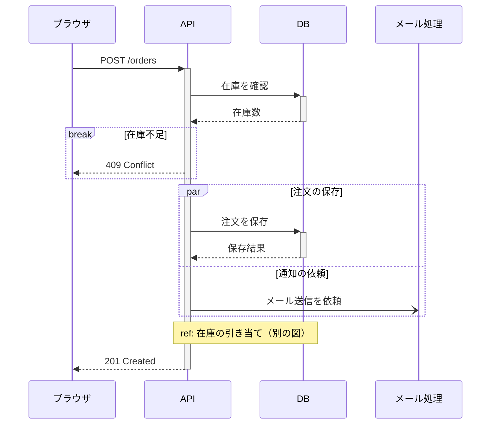

設計書に文章だけを書き連ねても、処理の流れは伝わりにくいものです。
「どの順番で」「誰が」「何をするか」を一目で把握するために、図を使います。

この章では、代表的な3つの図——**フローチャート**、**スイムレーン図**、**シーケンス図**——の使い分けと、Mermaidでの書き方を整理します。

<SpeechBubble character="/images/usingcomputer_suit_woman_color.png" name="学習者">
処理の流れを図にしたいんだけど、フローチャートとシーケンス図ってどう使い分けるの？
</SpeechBubble>

## フローチャート — 分岐ロジックの可視化

フローチャートは処理のステップと分岐を直線的に表現します。
1つのシステム・1人のアクターの処理を追うのに向いています。

### 基本記号と意味

フローチャートは、図形ごとに役割が決まっています。まずは次の5つを押さえれば、一般的な処理フローを読み書きできます。

<MermaidDiagram chart={`
flowchart TB
    START(["開始・終了"])
    PROCESS["処理"]
    DECISION{"判断・条件分岐"}
    IO[/"入力・出力"/]
    STORE[("データの保存先")]
    START ~~~ PROCESS ~~~ DECISION ~~~ IO ~~~ STORE
`} />

| 役割 | Mermaid記法 | 書く内容の例 |
|---|---|---|
| 開始・終了 | `A(["開始"])` | 開始、終了 |
| 処理 | `B["データを保存"]` | 計算、代入、API呼び出し |
| 判断・条件分岐 | `C{"入力は正しい?"}` | Yes / Noで答えられる条件 |
| 入力・出力 | `D[/"値を入力"/]` | ユーザー入力、画面表示 |
| データの保存先 | `E[("データベース")]` | DB、永続ストレージ |

<Marker>長方形には「行う処理」、ひし形には「答えによって進路が変わる質問」を書きます。</Marker>

基本的な条件分岐を、開始と終了まで含めて書くと次の形になります。

<MermaidDiagram chart={`
flowchart TB
    START(["開始"]) --> INPUT[/"X と Y を入力"/]
    INPUT --> CHECK{"X > Y?"}
    CHECK -->|Yes| YES["Ans ← 10"]
    CHECK -->|No| NO["Ans ← 20"]
    YES --> OUTPUT[/"Ans を表示"/]
    NO --> OUTPUT
    OUTPUT --> END(["終了"])
`} />

### 矢印・分岐・合流の読み方

- **矢印**は処理が進む方向を示す。通常は上から下、または左から右へ揃える
- **ひし形から出る矢印**には `Yes / No`、`成功 / 失敗`、`あり / なし` など、どちらの条件かを書く
- **分岐先が同じ処理へ戻る場合**は、上の `OUTPUT` のように2本の矢印を同じ長方形へつなげて合流させる
- **ループ**は後ろの処理から判断へ矢印を戻す。ただし交差する線が増えるなら、処理を分けるか別の図にする

<Callout type="warning" title="ひし形には質問を1つだけ書く">
「ログイン済みで管理者？」のように複数条件を1つへ詰め込むと、Noが何を意味するのか曖昧になります。「ログイン済み？」と「管理者？」を別々のひし形に分けましょう。
</Callout>

### Mermaidでの書き方

上の図は、次のMermaid記法で作れます。ここは完成形ではなく**図を生成するためのコード例**なので、コードブロックで表示しています。

`flowchart` の後ろは図が進む方向です。

| 指定 | 方向 | 向いている図 |
|---|---|---|
| `TB` / `TD` | 上から下 | 手順や分岐を順番に読む図 |
| `LR` | 左から右 | 工程が少ない横長の図 |
| `BT` | 下から上 | 下位から上位へ集約する図 |
| `RL` | 右から左 | 特別なレイアウトが必要な場合 |

ノードの `START` や `CHECK` は、図の中で要素を識別するIDです。表示する文言は括弧内の `"開始"` や `"X > Y?"` に書き、`-->` でノード同士をつなぎます。矢印の途中に `|Yes|` のように書くと、分岐条件を表示できます。

フローチャートは分岐の全体像を俯瞰するのに適していますが、**「誰が」その処理をしているか**が見えにくいという弱点があります。
1つのフローの中に「フロントの処理」「バックエンドの処理」「DBの処理」が混在すると、責任の所在が曖昧になります。

### いつフローチャートを使うか

- 分岐条件が多いビジネスロジック（割引計算、ステータス遷移など）
- 単一コンポーネント内の処理手順
- エラーハンドリングの全体像

## スイムレーン図 — 「誰が何をするか」を明確にする

<Figure src="/images/planning_suit_man_color.png" alt="フロー図を描く人" maxWidth="120px" />

スイムレーン図は、フローチャートに**アクター（担当者・システム）のレーン**を加えたものです。
複数のアクターが関わる処理では、フローチャートよりも「責任の所在」が一目で分かります。

<MermaidDiagram chart={`
flowchart TB
    subgraph Client["クライアント"]
        A["リクエスト送信"]
        H["レスポンス受信"]
    end
    subgraph APIGateway["APIゲートウェイ"]
        B["認証チェック"]
        C["ルーティング"]
    end
    subgraph Backend["バックエンドAPI"]
        D["バリデーション"]
        E["ビジネスロジック"]
    end
    subgraph DB["データベース"]
        F["クエリ実行"]
        G["結果返却"]
    end
    A --> B
    B --> C
    C --> D
    D --> E
    E --> F
    F --> G
    G --> E
    E --> H
`} />

レーンの境界がそのまま**責任の境界**になるため、「ここまではフロントの仕事、ここからはバックエンド」と視覚的に合意できます。

<SpeechBubble character="/images/usingcomputer_suit_woman_color.png" name="学習者">
設計レビューで「この処理、フロントとバックどっちの責任？」ってよく揉めるんだけど…
</SpeechBubble>

<SpeechBubble character="/images/relief_man_color.png" name="先生" side="right">
まさにそういう場面でスイムレーン図が効くんだ。レーンの境界が責任の境界になるから、文章で議論するよりずっと早く合意できるよ。
</SpeechBubble>

### いつスイムレーン図を使うか

- フロントエンド・バックエンド・外部サービスなど複数システムが連携する処理
- 設計レビューで「どこまでがどのレイヤーの責任か」を合意したいとき
- マイクロサービス間の連携フロー

## シーケンス図 — 時系列のメッセージ交換

シーケンス図は、複数の参加者が**どの順番でメッセージをやり取りするか**を表す図です。UML（Unified Modeling Language）で定義されている図の1つで、API呼び出しやログインのように、複数のシステムが往復する処理の設計によく使われます。

<SpeechBubble character="/images/usingcomputer_suit_woman_color.png" name="学習者">
複数のシステムが出てくるなら、さっきのスイムレーン図と同じじゃないの？
</SpeechBubble>

<SpeechBubble character="/images/oksign_man_color.png" name="先生" side="right">
スイムレーン図は各レーンの中の処理手順を見せる図です。シーケンス図は「APIがDBを呼んで、結果が返るまで待つ」のような呼び出しと応答の順番を見せます。
</SpeechBubble>

### シーケンス図の読み方

まずは部品の名前を確認します。次の図は、ブラウザから注文を送ったときの処理の一部です。

<Figure
  src="/images/system-design-sequence-anatomy.svg"
  alt="ブラウザ、API、DBの3者のやり取りを示したシーケンス図。上の四角が参加者、下に伸びる破線がライフライン、実線の矢印がメッセージ、破線の矢印が戻りメッセージ、ライフライン上の細長い四角が活性区間。時間は上から下へ進む"
  caption="図1: シーケンス図の部品。時間は上から下へ進む"
  maxHeight="none"
  maxWidth="720px"
/>

| 部品 | 図での形 | 表すもの |
|---|---|---|
| 参加者 | 上に並ぶ四角 | やり取りをするシステムや人 |
| ライフライン | 四角から下へ伸びる縦線 | その参加者が存在している期間 |
| メッセージ | 実線の矢印 | 呼び出しやリクエスト |
| 戻りメッセージ | 破線の矢印 | 呼び出しへの応答 |
| 活性区間 | ライフライン上の細長い四角 | その参加者が処理を実行している期間 |

図は次の順番で読みます。

1. 上に並んだ参加者を見て、登場するシステムを確認する
2. いちばん上の矢印から下へ順に、矢印の始点と終点を追う
3. 矢印のラベルで、何を送っているかを確認する

<Marker>縦方向が時間の順番、横方向が参加者です。</Marker>矢印の上下の位置は順番を表すもので、間隔が広くても処理時間が長いという意味にはなりません。

活性区間はUMLの仕様では `ExecutionSpecification` という名前で、資料によっては「アクティベーション」とも呼ばれます。省略している図も多いので、なくても読めるようにしておきましょう。

### Mermaidでの書き方

図1の流れに「注文を保存」を足した図は、Mermaidの `sequenceDiagram` で次のように書けます。

描画すると次の図になります。

<MermaidDiagram chart={`
sequenceDiagram
    participant B as ブラウザ
    participant A as API
    participant D as DB

    B->>+A: POST /orders
    A->>+D: 在庫を確認
    D-->>-A: 在庫数
    A->>+D: 注文を保存
    D-->>-A: 保存結果
    A-->>-B: 201 Created
`} />

| 記法 | 意味 |
|---|---|
| `participant B as ブラウザ` | 参加者を宣言する。`B` がコード内のID、`ブラウザ` が表示名 |
| `B->>A: 文言` | 実線の矢印でメッセージを書く |
| `A-->>B: 文言` | 破線の矢印で戻りメッセージを書く |
| `B->>+A` | 矢印の先の `A` の活性区間を始める |
| `A-->>-B` | 矢印の元の `A` の活性区間を終える |
| `autonumber` | 図の先頭に書くと、矢印に連番を振る |
| `Note over A,D: 文言` | `A` から `D` にまたがる注記を書く |

`participant` は省略しても、メッセージに登場した順に参加者が作られます。並び順を自分で決めたいときは、上の例のように先に宣言します。

<Callout type="warning" title="end という単語に注意">
Mermaidの公式ドキュメントでは、`end` という単語で図が壊れることがあると案内されています。`end` は `loop` や `alt` のブロックを閉じる構文でも使うためです。文言に含めるときは `(end)` や `[end]` のように括弧で囲みます。
</Callout>

### 同期メッセージと非同期メッセージ

矢印の先の形は、送信側が応答を待つかどうかを表します。

| 種類 | 送信側の動き | UMLの矢印 | Mermaid |
|---|---|---|---|
| 同期メッセージ | 応答が返るまで待つ | 実線＋塗りつぶした矢じり | `->>` |
| 非同期メッセージ | 応答を待たずに次へ進む | 実線＋開いた矢じり | `-)` |
| 戻りメッセージ | 呼び出し元へ応答する | 破線＋開いた、または塗りつぶした矢じり | `-->>` |

注文完了メールの送信を例に、2つの設計を比べます。

<Figure
  src="/images/system-design-sequence-sync-async.svg"
  alt="同期と非同期の比較図。左の同期では、APIはメール処理の結果を待ってからブラウザへ201を返す。右の非同期では、APIはメール処理へ依頼を送ったら待たずに201を返し、メール処理はそのあとも動き続ける"
  caption="図2: 同期ではメール送信の完了までブラウザへ応答できない。非同期では先に応答できる"
  maxHeight="none"
  maxWidth="720px"
/>

順番に見ていきます。

1. **同期の場合**は、APIがメール処理の結果を受け取ってから `201` を返します。メール送信が遅いと、注文の応答も遅くなります
2. **非同期の場合**は、APIが依頼を送った直後に `201` を返します。メール処理は、ブラウザへの応答が終わったあとも動き続けます

非同期の図をMermaidで書くと次の形です。

<SpeechBubble character="/images/usingcomputer_suit_woman_color.png" name="学習者">
コードで `await` を使っていれば、図でも非同期の矢印にするの？
</SpeechBubble>

<SpeechBubble character="/images/relief_man_color.png" name="先生" side="right">
`await` は結果が返るまで次の行へ進まないので、この本では同期の矢印 `->>` で書きます。言語の構文ではなく、処理の流れの中で応答を待つかどうかで選びましょう。
</SpeechBubble>

非同期にすると、失敗をブラウザへの応答で伝えられなくなります。失敗をどこで受けるかは、[エラー設計の「非同期処理のエラー戦略」](/books/system-design/10-error-handling-design)で扱います。

### 分岐と繰り返し — alt / opt / loop

シーケンス図では、条件によって変わる範囲を枠で囲みます。この枠はUMLでは複合フラグメント（`CombinedFragment`）と呼ばれます。

| 構文 | 意味 | 使う場面の例 |
|---|---|---|
| `alt` / `else` | 複数の選択肢から、条件に合うものを実行する | 在庫があれば保存、なければエラー |
| `opt` | 条件に合うときだけ実行し、合わなければ何もしない | クーポンの指定があるときだけ検証 |
| `loop` | 枠の中を繰り返す | カートの商品ごとに在庫を確認 |

3つを使った注文処理の図です。

<Figure
  src="/images/system-design-sequence-fragments.svg"
  alt="注文処理のシーケンス図。loopの枠でカートの商品ごとに在庫確認を繰り返し、optの枠でクーポン指定があるときだけ検証し、altの枠で在庫があれば注文を保存して201を返し、在庫不足なら409を返す"
  caption="図3: loop、opt、altの範囲。altの破線が2つの選択肢の境目"
  maxHeight="none"
  maxWidth="720px"
/>

Mermaidでは、各ブロックを `end` で閉じます。

この例では、APIの活性区間を選択肢ごとに閉じず、`alt` の枠を抜けたあとの `deactivate A` で閉じています。

### 並行・中断・別の図の参照 — par / break / ref

`alt`・`opt`・`loop` のほかに、設計書でよく見る枠が3つあります。

| 枠 | 意味 | 使う場面の例 | Mermaid |
|---|---|---|---|
| `par` | 枠の中の各区画を並行に実行する | 注文の保存とメール送信の依頼を同時に進める | `par` / `and` / `end` |
| `break` | 条件に合ったら枠の中を実行し、**そこで残りの処理を打ち切る** | 在庫不足ならエラーを返して終わる | `break` / `end` |
| `ref` | 別のシーケンス図に書いたやり取りを、ここで行う | 複数の図に共通する認証の流れを1つの図にまとめる | 専用の構文なし |

<SpeechBubble character="/images/question_woman_04_color.png" name="学習者">
`break` は、`alt` で「在庫不足」の選択肢を書くのと何が違うの？
</SpeechBubble>

`alt` で書くと、正常系の処理がすべて `alt` の枠の中に入ります。エラーの条件が3つあれば、枠が3重になります。`break` は「この条件なら、ここで終わり」だけを枠にするので、正常系は枠の外に残り、上から下へそのまま読めます。入力チェックや在庫不足のような、早い段階で処理を打ち切る失敗に向いています。

`break` と `par` を使って、注文処理を書き直した図です。

<MermaidDiagram chart={`
sequenceDiagram
    participant B as ブラウザ
    participant A as API
    participant D as DB
    participant M as メール処理

    B->>+A: POST /orders
    A->>+D: 在庫を確認
    D-->>-A: 在庫数

    break 在庫不足
        A-->>B: 409 Conflict
    end

    par 注文の保存
        A->>+D: 注文を保存
        D-->>-A: 保存結果
    and 通知の依頼
        A-)M: メール送信を依頼
    end

    Note over A,D: ref: 在庫の引き当て（別の図）
    A-->>-B: 201 Created
`} />

`ref` はUMLでは `InteractionUse` と呼ばれ、枠の左上に `ref` と書き、中に参照先の図の名前を書きます。Mermaidには `ref` に当たる構文がありません（[公式ドキュメント](https://mermaid.js.org/syntax/sequenceDiagram.html)に記載がなく、バージョン11.17で確認）。上の例では、`Note over A,D:` で参加者にまたがる注記を置き、文言を `ref:` で始めて代用しています。これは筆者の書き方で、決まった記法ではありません。

### 書くときに気をつけること

ここからは仕様ではなく、筆者が設計レビューで見ている目安です。

- **1つの図に1つのユースケースを書く。** 「注文」と「キャンセル」を同じ図に入れると、`alt` が増えて順番を追いにくくなります
- **参加者の粒度を揃える。** 「ブラウザ」「API」「DB」の中に関数名を混ぜると、見るべき層が曖昧になります
- **矢印のラベルに実際の値を書く。** 「データを送る」ではなく `POST /orders` や `409 Conflict` と書くと、API仕様と照合できます
- **失敗の経路も書く。** 正常系だけの図では、エラー時に何を返すかをレビューで確認できません
- **分岐の中身が多くなったら図を分ける。** `alt` の中にさらに `alt` が必要になったら、判断の部分はフローチャートに切り出すことを検討します

実際の例として、[認証と認可の設計](/books/system-design/08-authentication-authorization)ではOAuth 2.0の認可コードフローをシーケンス図で示しています。

## フローチャート・スイムレーン・シーケンス図の使い分け

| 図 | 焦点 | 適するケース |
|---|---|---|
| **フローチャート** | 処理の分岐 | 単一コンポーネントのロジック、分岐条件の整理 |
| **スイムレーン図** | 責任の所在 | 複数アクターの連携、責任分界点の合意 |
| **シーケンス図** | 時系列のやりとり | リクエスト→レスポンスの往復、非同期処理の順序 |

<Callout type="column">
スイムレーン図はフローチャートの拡張（レーンを追加したもの）、シーケンス図はアクター間のメッセージの時系列表現です。どちらも「複数アクターの連携」を表現できますが、スイムレーンは**各アクター内部の処理ステップ**も見せられる点が異なります。迷ったら「内部の処理分岐も見せたいか、やりとりの順序だけ見せたいか」で選びましょう。
</Callout>

## ちゃんと使うためのポイント

- <Marker>フローチャートは分岐ロジックの整理に、スイムレーンは責任分界点の明確化に使う</Marker>
- 複数アクターが絡む処理をフローチャートだけで書くと「誰の責任か」が曖昧になる
- シーケンス図はリクエスト→レスポンスの往復を時系列で示したいときに使う
- シーケンス図の矢印は、応答を待つなら同期（`->>`）、待たないなら非同期（`-)`）で書き分ける
- 条件で変わる範囲は `alt`、`opt`、`loop` の枠で囲む
- 早い段階で打ち切る失敗は `break`、並行に進める処理は `par` で書く
- すべての処理を図にする必要はない——**分岐が多い処理**や**複数システムが連携する処理**に絞る

## 参考リンク

- [Mermaid公式 — Flowcharts Syntax](https://mermaid.js.org/syntax/flowchart.html) — ノードの形、矢印、ラベル、サブグラフなどの公式記法
- [Mermaid公式 — Sequence diagrams（英語）](https://mermaid.js.org/syntax/sequenceDiagram.html) — 矢印の種類、活性区間、`loop`、`alt`、`opt`、`par` の公式記法
- [UML 2.5.1仕様（英語・PDF）](https://www.omg.org/spec/UML/2.5.1/PDF) — 17.4.4.1 Messageに矢印の表記、17.6.3にCombinedFragmentの各演算子（`alt`・`opt`・`loop`・`par`・`break`）の定義、17.7にInteractionUse（`ref`）の定義

ユーザーの操作に伴うページ間の移動は、[画面遷移図の章](/books/system-design/17-screen-transition)で扱っています。
